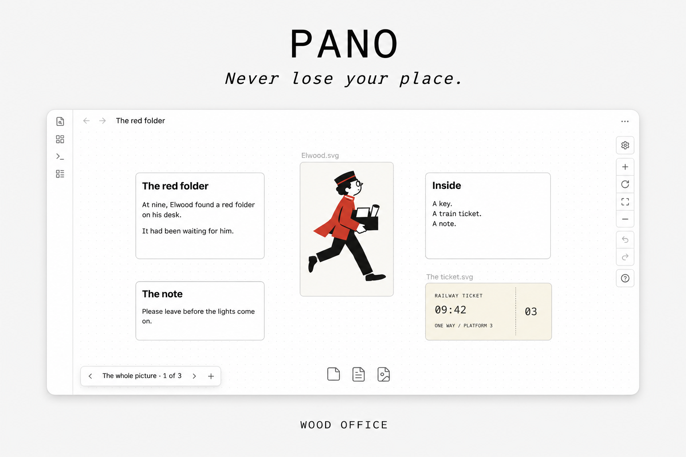

# Pano

Never lose your place.

Pano saves named views of your Obsidian Canvas. Keep one scene for the whole picture, another for the details, and move between them with a shortcut.

By WOOD OFFICE.

## Use

1. Frame a view on your canvas and press **+** in the scene navigator.
2. Open **Manage scenes** to give it a name.
3. Use the arrows to move between your scenes. Select the scene name to choose one directly.
4. To add shortcuts, open **Settings → Pano → Configure shortcuts**. None are assigned by default.

Each scene remembers your position and zoom. Your cards stay live as you work; scenes save views rather than copies of the board. The manager also lets you replace a view, reorder scenes, or delete one with Undo.

[Get Pano from the Obsidian Community directory](https://community.obsidian.md/plugins/canvas-scenes).

## Settings

**Navigator.** Show or hide the scene controls on your canvas. Keyboard commands continue to work when the controls are hidden.

**Motion.** Travel smoothly between scenes or jump straight to them. Pano respects your system’s Reduce Motion preference.

## Privacy

No network requests or telemetry. Pano stores its scenes and settings through Obsidian and does not edit your Canvas files.

## Compatibility and data

Requires Obsidian 1.15.1 or newer on desktop. Verified on macOS. Pano uses internal Canvas camera methods and may need updates when Obsidian changes.

Scenes are stored in the plugin’s `data.json` by Canvas path. Preserve that file when updating or backing up. See the [data and compatibility notes](docs/DATA.md) for renames, copying canvases and syncing between devices.

## Support

Found a bug? Use the [GitHub issue tracker](https://github.com/woodoffice/obsidian-pano/issues).

## Development

See [development and manual installation](docs/DEVELOPMENT.md), [release verification](docs/RELEASE.md), and [verified camera behavior](docs/CAMERA.md).

## License

MIT · WOOD OFFICE
