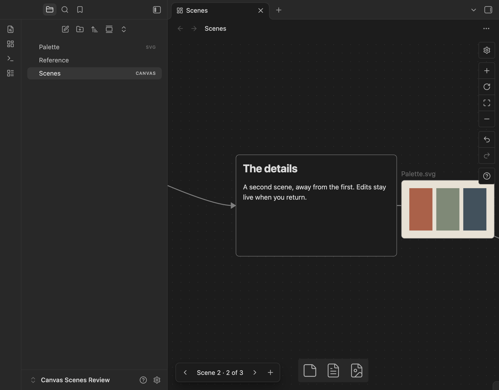

# Pano

Never lose your place.

Save named views of your Obsidian Canvas and move between them smoothly. Pano remembers your position and zoom, making it easy to navigate large canvases without losing your bearings.

By WOOD OFFICE.

Version **0.1.2**, verified against Obsidian **1.15.1** on macOS. This build uses internal Canvas camera methods; future Obsidian updates may require a compatibility update. iPad, Windows and Linux have not been verified.



## Use

Open a Canvas, pan and zoom to frame a view, then click **+** in the lower-left scene navigator. Choose its title to visit a saved scene or open **Manage scenes…**. In narrow panes the navigator sits above Canvas's native add-card controls.

The manager offers Rename, Replace with current view, Move earlier/later and Delete. A deletion has an Undo button for ten seconds. Previous/next stop at the ends. Manual panning keeps your last visited scene as the navigation anchor; it does not update the saved frame.

A scene displays live board content. It does not save an image or restore an older version of your cards. On a differently sized pane, the entire saved frame stays visible, with extra space around it as needed.

Navigation travels smoothly between scenes with eased camera movement and a subtle pullback. Trips take roughly 0.28–0.55 seconds, depending on distance. Panning, zooming or another command can interrupt travel; another scene choice retargets from the current position. Saving during a trip stops the camera and captures the visible frame. With the system's Reduce Motion preference enabled, scenes jump into place immediately.

## Settings

In **Settings → Pano**:

- **Show scene navigator** displays the controls on each canvas.
- **Animate scene changes** enables smooth travel. Turn it off for immediate jumps. The system’s reduced motion preference is always respected.

Both preferences are saved with the scene collection and take effect immediately.

## Keyboard commands

In **Settings → Pano**, select **Configure shortcuts**. This opens Hotkeys filtered to Pano's commands. You can also open **Settings → Hotkeys** and search for **Pano** yourself.

Choose your preferred bindings, for example:

| Command | Suggested macOS shortcut |
| --- | --- |
| Save scene | ⌘⇧S |
| Previous scene | ⌥⌘← |
| Next scene | ⌥⌘→ |

Choose scene, Manage scenes and Show scene navigator are also available from the command palette. The last command toggles the navigator; keyboard commands continue to work when it is hidden.

No default shortcuts are imposed. Choose bindings in Obsidian’s native Hotkeys page.

The suggested previous/next bindings overlap Obsidian's default back/forward navigation shortcuts on macOS. The native Hotkeys page displays conflicts so you can choose different bindings if desired.

## Install a local build

Copy `main.js`, `manifest.json` and `styles.css` into `<vault configuration folder>/plugins/canvas-scenes/`, then enable Pano in Obsidian's Community plugins settings. Preserve any existing `data.json` when updating. The usual configuration folder is `.obsidian`, but Obsidian supports other names.

Pano is available in the [Obsidian Community directory](https://community.obsidian.md/plugins/canvas-scenes). For manual installation, download the three plugin assets from the [latest GitHub release](https://github.com/woodoffice/obsidian-pano/releases/latest).

## Data and privacy

Scenes are saved in the plugin's `data.json`, indexed by vault-relative Canvas path. Canvas files are not modified. File and folder renames observed by Obsidian keep their scenes. Metadata for missing/deleted files is retained so a restored file at the same path can recover its scenes.

Copying or duplicating a `.canvas` file alone does not carry its scenes. Renaming files while Obsidian is closed may break their path association. Cross-device transfer depends on syncing plugin data; simultaneous-device conflict resolution is not provided. Back up plugin data alongside your vault if the scene collection matters to you.

Invalid or newer-format scene data is preserved and saves are disabled until valid data is restored. An unsupported camera disables navigation without deleting scenes.

The optional filtered-Hotkeys button also uses a guarded internal Obsidian settings route. If that route changes, it falls back to instructions for opening Hotkeys manually.

There are no network requests, analytics, external services or runtime plugin dependencies.

## Development

```sh
npm ci
npm run build
npm run lint
npm test
npm run check:release
npm run setup:review
npm run deploy:review
```

Open `work/Canvas Scenes Review` as a vault and enable the local plugin. Setup creates disposable fixture files and does not overwrite existing files. Deploy updates the three plugin assets and preserves scene data. `work/` and built assets are ignored by Git.

`scripts/eval.mjs` targets only the named review vault using Obsidian's developer CLI. `scripts/verify-desktop.js` and `scripts/verify-lifecycle.js` exercise the real app; inspect their fixture-only changes before running. They require the CLI to be enabled and the review vault open. The desktop script creates three review scenes on its first run.

Camera internals are isolated in `src/camera.ts`. The platform-independent model, geometry, storage validation and serialized transactions are in `src/model.ts`. Controls and commands are in `src/main.ts`; standard Obsidian dialogs are in `src/dialogs.ts`.

## Review verification

Typecheck, production build, Obsidian ESLint checks and 15 automated tests pass. Real-app checks covered camera accuracy, aspect-ratio changes, scene commands, separate pane cameras, file/folder renames, metadata persistence after vault reload, plugin cleanup, write failure, read-only boards and preservation of newer-format data. Rename (including Enter), reorder, delete and Undo were exercised through the native UI. Light and dark layouts and two narrow panes were inspected. Animation checks verified intermediate camera positions, exact landing, rapid retargeting, wheel interruption, Reduce Motion, and cancellation when the plugin is disabled.

Physical shortcut dispatch while editing a card also passed: ⌘⇧S saves a scene without losing editor focus, typing continues afterward, and ⌥⌘← / ⌥⌘→ navigate while preserving the card text. Temporary test changes were removed and the existing scenes were preserved.

Both native preferences were toggled through the UI and retained after plugin reload, preserving the existing scenes. The filtered-shortcuts button opened the native Hotkeys page with only Pano's six commands.

The initial desktop workflow was accepted in review. Full-app restart, other operating systems, alternate community themes and mobile hardware remain unverified. GitHub and directory review status is recorded in the release-readiness document.

Local release verification also checks manifest/version consistency, shipping CSS, runtime imports and release assets. A separate clean-install check compares a fresh production bundle byte for byte. These do not replace the directory’s hosted preview scan.

See [release readiness](docs/RELEASE.md), [specification](SPEC.md) and [verified camera behavior](docs/CAMERA.md).

## License

MIT · WOOD OFFICE
